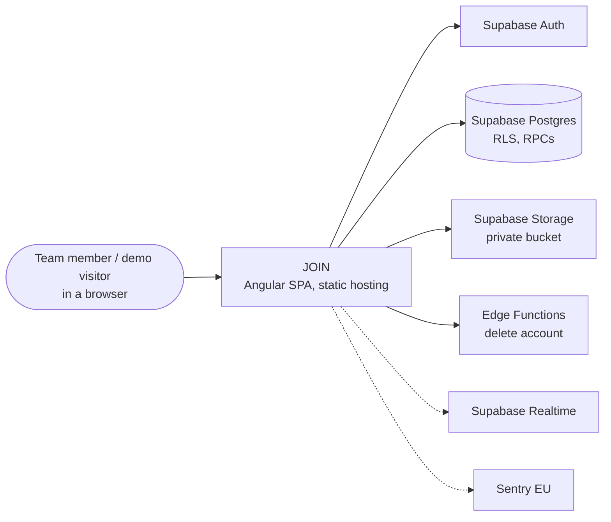

# JOIN in one page (arc42-lite)

A short architecture description in the [arc42](https://arc42.org/) shape, with the sections that help a newcomer: 1 goals, 3 context, 5 building blocks, 6 runtime, 8 concepts, 9 decisions. It is the single newcomer document; each feature that changes the structure updates it in the same PR.

## 1. Introduction and goals

JOIN is a Kanban board for small teams (see `context/project-overview.md`). What the architecture has to deliver, in order:

1. **A user sees only the data of their workspaces** — enforced by Postgres RLS, proven by integration tests, never by the Angular code alone
2. **A newcomer or an AI assistant knows where code goes** — feature folders with fixed roles, boundaries checked by the lint (`context/architecture-rules.md`)
3. **Accessible and usable on desktop and phone** — WCAG 2.1 AA (BFSG), drag and drop with a keyboard alternative
4. **Every change is checked before it reaches users** — lint, unit, integration and E2E tests in CI, previews per PR

## 3. Context and scope



Solid lines exist today (Storage from feature 9), dashed lines are planned (Realtime: feature 17, Sentry: feature 11). The browser talks to Supabase directly with the public publishable key; there is no own backend server ([ADR 0001](adr/0001-supabase-as-backend.md)).

## 5. Building block view

Target layout after feature 5 (the rules are in `context/architecture-rules.md`):

```text
app.routes.ts ─ lazy routes ─▶ features/*/pages   (containers)
                                   │ inject
                                   ▼
                             features/*/data-access/*.store.ts   (NgRx SignalStore, resource())
                                   │ call
                                   ▼
                             features/*/data-access/*.repository.ts ─▶ core/supabase ─▶ Supabase
pages ─ inputs/outputs ─▶ features/*/ui, shared/ui   (presentational)
```

| Feature | Owns |
| --- | --- |
| `auth` | session, sign-in/up, demo (anonymous) sign-in, password reset, account deletion, guards |
| `workspaces` | workspaces, members, invitations, the current workspace (feature 7) |
| `contacts` | the contacts of a workspace |
| `tasks` | tasks, subtasks, assignees, files; the task form and detail |
| `board` | the Kanban view, drag and drop, search |
| `summary` | the dashboard |
| `legal` | legal notice, privacy policy, help, accessibility statement |

## 6. Runtime view

Today: on startup `provideAppInitializer` restores the session; `MainLayout` loads all contacts and tasks; creating or editing a task calls one RPC (task and assignees in one transaction) and reloads that task; moving a task or toggling a subtask updates the UI first and rolls back on error.

The flows of later features (anonymous demo, invitations, uploads to Storage, realtime) are added here by the feature that builds them.

## 8. Cross-cutting concepts

- **State**: signals; feature stores (NgRx SignalStore from feature 5); `computed` for everything derived
- **Errors**: repositories map Supabase errors to typed errors; stores expose error state; a global `ErrorHandler` reports the unexpected (feature 11)
- **Security**: RLS on every table, Storage policies, Edge Functions verify the caller; the client holds only the publishable key
- **Accessibility**: native elements, CDK a11y, lint rules for templates, axe in tests
- **Testing**: see "Testing" in `context/coding-standards.md`

## 9. Architecture decisions

See [adr/README.md](adr/README.md).
